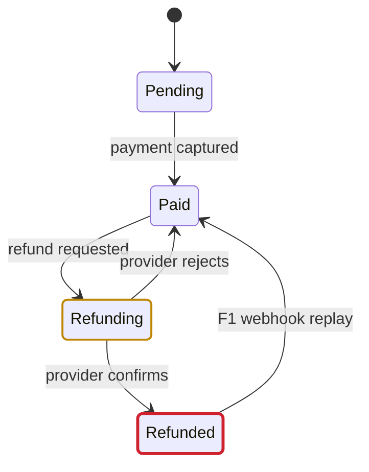

# review-diagrams

A review diagram answers one **question** that a reviewer has. It leads with the **big picture**: a one-line plain answer, then the diagram, with the details one click away. Every node and edge is **evidence**: it names code, a spec clause, or a rule the user stated.

The diagram is a fenced `mermaid` block in Markdown. That text is the source of truth. GitHub, Obsidian, editors, and agents all read it, and it diffs like code. The review page and every other view are built from it.

## Steps

1. **Question**: Write the question in one sentence, such as "Which states can an order reach after a refund?" Done when the question names one flow, one set of states, or one structure.
2. **Type**: Pick the diagram type from [Choose the type](#choose-the-type).
3. **Evidence**: Read the code or spec behind every node and edge. Record its `file:line` or spec section. Done when every node and edge has a source. A path that the code allows and the spec forbids, or the reverse, is a **finding**.
4. **Draw**: Write the block to [Layout](#layout) and [Draw rules](#draw-rules).
5. **Check**: Run `bun <this skill's folder>/scripts/pele-check.ts FILE...` on each `.md` or `.mmd` file. Fix each error at the `file:line:column` it prints. Done when the command exits 0.
6. **Deliver**: Pick the view from [Views](#views).

## Layout

Each diagram in a Markdown file has three parts, in this order:

1. **Headline**: The line above the fence. It answers the question in plain words, 12 words at most, such as "A replayed webhook can un-refund an order."
2. **Fence**: The `mermaid` block.
3. **Evidence**: A list right below the fence. One item per node or edge group, with `file:line`. Each finding starts with its bold number, such as `**F1**`.

The check script reads this layout. The headline becomes the page title for the diagram. Each `**F1**` item counts as a finding.

## Views

| Reader | View |
| --- | --- |
| PR body, review comment, spec file | Paste the Markdown layout as it is. |
| A colleague who wants a page | In Claude Code, run the check with `--html OUT.html --artifact`, publish `OUT.html` with the Artifact tool, and share the link. Elsewhere, run it with `--html OUT.html` and send the file. |
| The user, in chat, for a quick point | Use the show-me skill. Reuse the checked block. |
| A polished, explorable diagram with motion or image export | Use the archify skill. Give it the checked block as its Mermaid input. |
| A subagent | Paste the block into the brief as the shared model. Ask the agent to report each edge that the code contradicts, with `file:line`. |

The `--html` page is self-contained. Pele renders every SVG at build time, so the page loads no scripts. An Artifact renders a plain `mermaid` fence with its own Mermaid.js, but only this page adds the walker, the findings, and the evidence. The page gives each diagram:

- the headline, large, with a type badge and a finding count
- a **walker** for state diagrams: the reader picks events, steps through states, and copies the path as a test scenario
- **Copy XState** for state diagrams: an XState `createMachine` config that Stately Studio imports
- **Copy Mermaid**, the evidence, and the source behind clicks
- light and dark themes, and a phone layout

The walker reads the top-level states only. States inside a composite state stay in the picture but not in the walker.

## Choose the type

| Question | Type |
| --- | --- |
| Which steps run, and where does the logic branch? | `flowchart` |
| Who calls whom, and in what order? | `sequenceDiagram` |
| Which states exist, and which events move between them? | `stateDiagram-v2` |
| Which team or system owns each step? | `swimlane-beta` |
| Which commands produce which events, and which views read them? | `eventmodeling` |
| Which services or modules exist, and what depends on what? | `C4Container`, `C4Component`, `architecture-beta` |
| Which types and contracts relate? | `classDiagram` |
| Which records relate, and with what cardinality? | `erDiagram` |
| Which component satisfies which requirement? | `requirementDiagram` |
| Which agents, tools, and inputs make up an agent run? | `agentflow-beta` |
| How do branches split and merge? | `gitGraph` |
| What is the order and overlap of work? | `gantt`, `timeline` |

Syntax for every type: <https://pele.run/examples>. Pele does not support ZenUML or other Mermaid plugins.

GitHub renders `mermaid` blocks with its own Mermaid.js version, which can lag behind Pele. For a PR body or comment, prefer the types without `-beta`. When a `-beta` type answers the question better, link the review page too.

## Draw rules

- **One question**: One diagram answers one question. Split a diagram at about 15 nodes.
- **Few words**: Node labels are 1 to 3 words. Put detail in the evidence list, not in the picture.
- **Domain words**: Labels use the names in GLOSSARY.md or the code, so a reader can search for them.
- **Edge labels**: An edge carries its condition or event, such as `refund approved` or `POST /orders`. In a state diagram, the edge label is the event name that the walker and the XState export use.
- **Change marks**: For a diff, draw the changed nodes and their direct neighbours. Mark each changed node with a class from the block below.
- **Findings**: Mark each finding with the `finding` class. Put its number on the node or edge label.

```text
classDef added stroke:#2da44e,stroke-width:2px
classDef changed stroke:#bf8700,stroke-width:2px
classDef removed stroke:#6e7781,stroke-dasharray:4 3
classDef finding stroke:#cf222e,stroke-width:3px
```

## Example

A review of a refund change, in the Markdown layout:

A replayed webhook can un-refund an order.



- `Paid --> Refunding`: `src/orders/refund.ts:42`
- `Refunding --> Paid`: `src/orders/refund.ts:77`
- **F1**: `src/webhooks/payment.ts:31` sets `Paid` on any capture event. Spec section 4.2 says `Refunded` is final.
